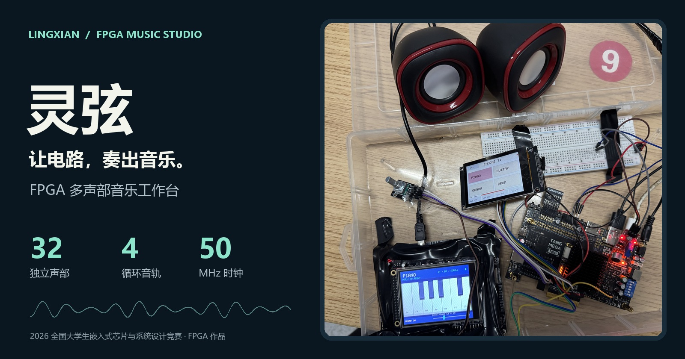
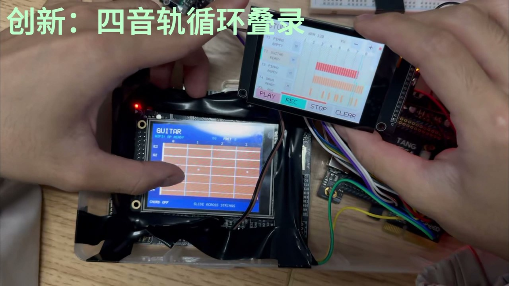
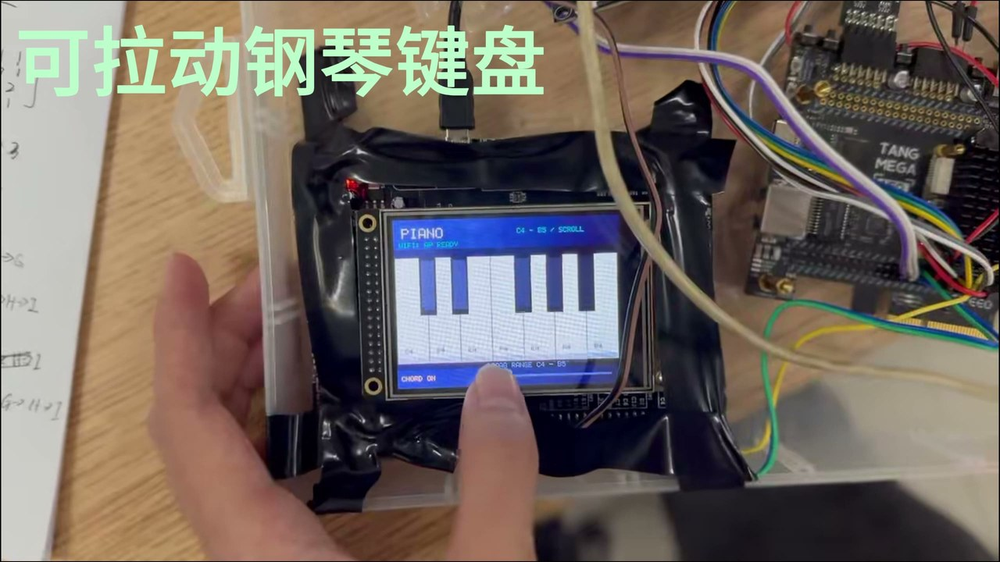
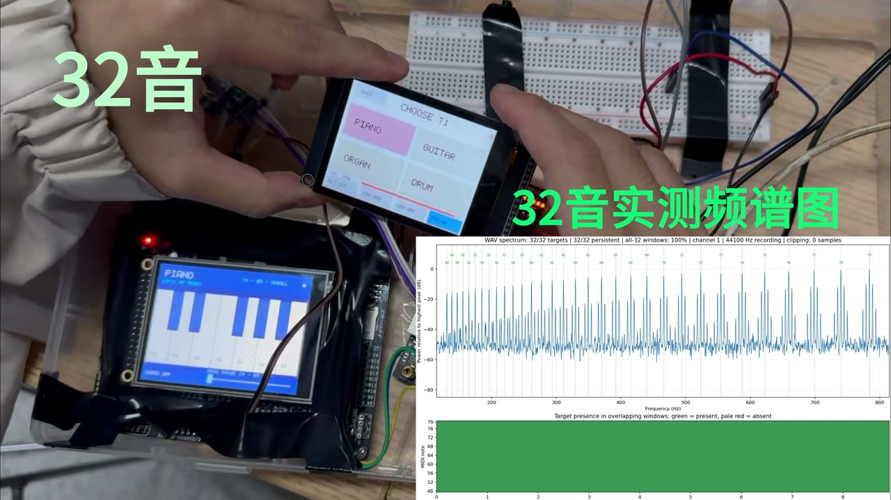
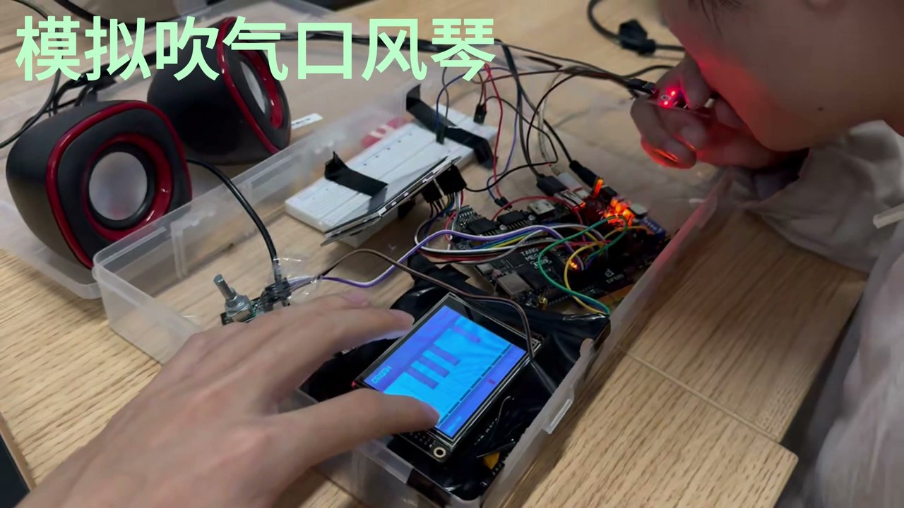
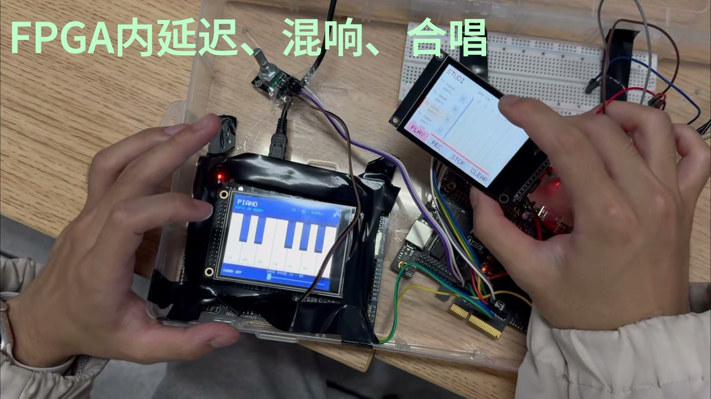
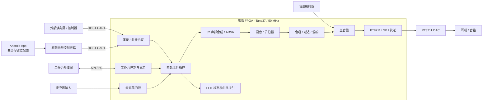
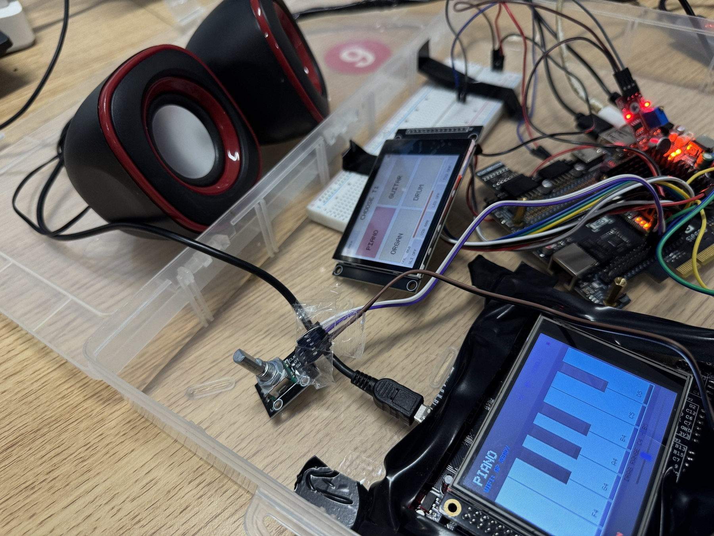
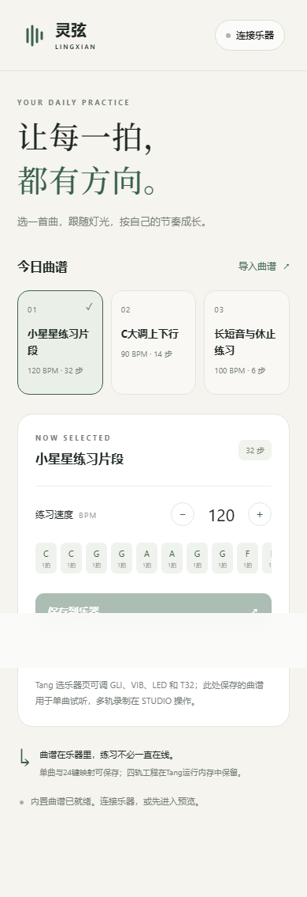

<div align="center">



# 灵弦 · Lingxian

**让电路，奏出音乐。**

基于高云 FPGA 的 32 声部实时合成与四轨循环音乐工作台<br>
2026 嵌入式大赛 · FPGA 作品


[**作品主页与演示视频 →**](https://Oo511.github.io/Lingxian_FPGA/) · [下载视频 / 固件 / APK](https://github.com/Oo511/Lingxian_FPGA/releases/tag/v1.0.0) · [快速上手](#快速上手) · [工程导航](#工程导航)

</div>

## 一个可以演奏、叠录和合奏的 FPGA 音乐系统

灵弦把数字乐器、效果器和循环工作台放进同一条硬件音频链路：触摸演奏产生音符，FPGA 完成多声部合成、包络、混音与效果处理，再通过 PT8211 输出声音。四轨事件循环叠录让旋律、和弦与鼓点逐层组合；配套 Android App 用于曲谱与键位配置。

| 能力 | 实现与交互 |
| --- | --- |
| **32 声部实时合成** | FPGA 内实现声部合成、ADSR 包络、多级混音与声部活动显示 |
| **四轨循环叠录** | 事件录制、循环回放、叠录、静音与轨道音色切换，录音保存在片内 RAM |
| **多种演奏方式** | 钢琴、吉他、风琴、鼓声；作品演示包含滑音、和弦与模拟吹气口风琴 |
| **硬件效果器** | 延迟、混响、合唱，配合滑音 / 颤音与旋转编码器主音量控制 |
| **屏幕与指引** | 工作台显示、触摸操作、LED 曲目指引及麦克风门控 |
| **手机协作** | Android 原生 Java 壳 + Web 界面，配置曲谱、键位与单曲播放 |

## 看看它如何演奏

[](https://Oo511.github.io/Lingxian_FPGA/#demo)

**[▶ 观看约 2 分 32 秒完整演示](https://Oo511.github.io/Lingxian_FPGA/#demo)**　[原始 1440p 视频下载](https://github.com/Oo511/Lingxian_FPGA/releases/download/v1.0.0/42118.mp4)

主页视频支持章节跳转，可直接观看触摸演奏、32 声部、口风琴、效果器、手机配置和四轨叠录。视频记录作品的实际演示，归档代码版本的验证状态见下方报告。

<table>
  <tr>
    <td width="50%"><br><b>触摸演奏</b> · 可拉动键盘与实时交互</td>
    <td width="50%"><br><b>32 声部</b> · 视频中的合成与频谱展示</td>
  </tr>
  <tr>
    <td><br><b>口风琴模式</b> · 吹气控制与触摸音符配合</td>
    <td><br><b>FPGA 效果器</b> · 延迟 / 混响 / 合唱</td>
  </tr>
</table>

## 系统架构



正式工程的音频输出使用 **PT8211 LSBJ 格式**；源码中的标准 `i2s_tx` 是随附模块，当前顶层连接的是 `pt8211_tx`。外部控制器 / 无线网桥的固件未包含在此代码包中。

## 实物与手机界面

<table>
  <tr>
    <td width="66%"><br>开发板、演奏屏、工作台屏与音频输出</td>
    <td width="34%"><br>配套 Android App · 曲谱配置界面</td>
  </tr>
</table>

## 工程导航

保留原代码包的目录与版本命名，方便与原始报告对应。

| 目录 | 内容 | 适用范围 |
| --- | --- | --- |
| [01 · Tang37 正式 FPGA 工程](Lingxian_FPGA_All/01_Tang37_现有FPGA完整工程/) | Verilog、Gowin 工程、引脚 / 时序约束、仿真、码流、原始报告 | 当前归档主工程，外部演奏输入沿用 HOST 接口 |
| [02 · 双屏 + ESP32 概念工程](Lingxian_FPGA_All/02_双同型屏_ESP32_概念工程40/) | 假设两块同型触摸屏的 FPGA 集成与仿真 | 概念验证；无新硬件约束 / 码流，ESP32 网桥固件未实现 |
| [03 · 演奏控制 HDL](Lingxian_FPGA_All/03_演奏控制HDL迁移与对照测试/) | 独立演奏映射核心、19,514 组对照向量与测试 | 算法迁移与复用，保留差分测试依据 |
| [04 · Android App](Lingxian_FPGA_All/04_Android_App_34/) | Java 原生壳、Web UI、协议、测试、构建工具与 APK | 现有原配无线链路；概念工程的 ESP32 适配仍待完成 |
| [docs](docs/) | 作品展示网站、实物照片与演示截图 | GitHub Pages 静态主页 |

详细交付边界见[代码包原始说明](Lingxian_FPGA_All/00_先读我.md)与[复现说明](docs/reproduction.md)。

## 快速上手

### 1. 获取代码

```powershell
git clone https://github.com/Oo511/Lingxian_FPGA.git
cd Lingxian_FPGA
```

### 2. 打开正式 FPGA 工程

用 Gowin IDE 打开：

```text
Lingxian_FPGA_All/01_Tang37_现有FPGA完整工程/FPGA/screen_board.gprj
```

- 器件：`GW5AT-LV60PG484AC1/I0`（GW5AT-60B）。
- 顶层：`studio_board_top`，位于 `FPGA/src/studio_board_top.v`。
- 引脚：`FPGA/src/screen_board.cst`；时序：`FPGA/src/timing.sdc`，50 MHz / 20 ns。
- 归档工具版本：Gowin `V1.9.11.03 Education`。
- 现成码流：`download/music_perform.fs`，也可从 [Release](https://github.com/Oo511/Lingxian_FPGA/releases/tag/v1.0.0) 下载。

脚本构建与仿真命令、Android 构建依赖见[复现说明](docs/reproduction.md)。烧录应使用与原约束匹配的硬件及外部控制输入；复位 / 重新下载会清空 RAM 中的四轨录音。

### 3. 使用配套 App

从 [Release](https://github.com/Oo511/Lingxian_FPGA/releases/tag/v1.0.0) 下载 `Lingxian-Android.apk`。也可以直接打开 `04_Android_App_34/dist/quick-open.html`，查看网页界面并使用内置模拟设备体验配置流程。公开仓库不包含 Android 签名私钥；自行构建会生成新的本地演示签名。

## 验证记录

以下为**随包归档的工具报告**，与实物演示区分列示：

| 项目 | 归档结果 | 依据 |
| --- | --- | --- |
| Tang37 静态时序 | 50 MHz；Setup / Hold 违例均为 0；报告 Fmax 60.986 MHz | [validation37.json](Lingxian_FPGA_All/01_Tang37_现有FPGA完整工程/reports/validation37.json) · [时序报告](Lingxian_FPGA_All/01_Tang37_现有FPGA完整工程/reports/timing/screen_board_tr_content.html) |
| FPGA 资源 | Logic 41,294 / 59,904；BSRAM 97 / 118；DSP 118 / 118 | [布局布线报告](Lingxian_FPGA_All/01_Tang37_现有FPGA完整工程/reports/timing/screen_board.rpt.txt) |
| 正式工程回归 | 6 项针对性仿真记录 | [reports/sim](Lingxian_FPGA_All/01_Tang37_现有FPGA完整工程/reports/sim/) |
| 演奏映射差分 | 19,514 组输入，键位 / 增益 / 音符一致 | [对照测试记录](Lingxian_FPGA_All/03_演奏控制HDL迁移与对照测试/sim/result.log) |
| 双屏概念 | 顶层与基础显示仿真 | [概念工程说明](Lingxian_FPGA_All/02_双同型屏_ESP32_概念工程40/README.md) |
| Android / Web | 原报告包含 APK 构建与签名、7 项协议测试、18 项页面检查 | [App reports](Lingxian_FPGA_All/04_Android_App_34/reports/) |

原 Tang37 验证文件标注 `physical_test_pending: true`。本次整理发布不新增该版本的实机验收、端到端延迟或概念工程硬件适配结论。概念工程尚未完成 Wi-Fi 网桥与非易失曲谱保存。

## 项目与素材说明

作者 / 维护者：[Oo511](https://github.com/Oo511)。实物照片与演奏视频来自本作品提供的原始素材；主页图片做了尺寸优化，未修改硬件内容。原始代码中的许可证与署名予以保留，整体使用范围见[使用与署名说明](docs/attribution.md)。
